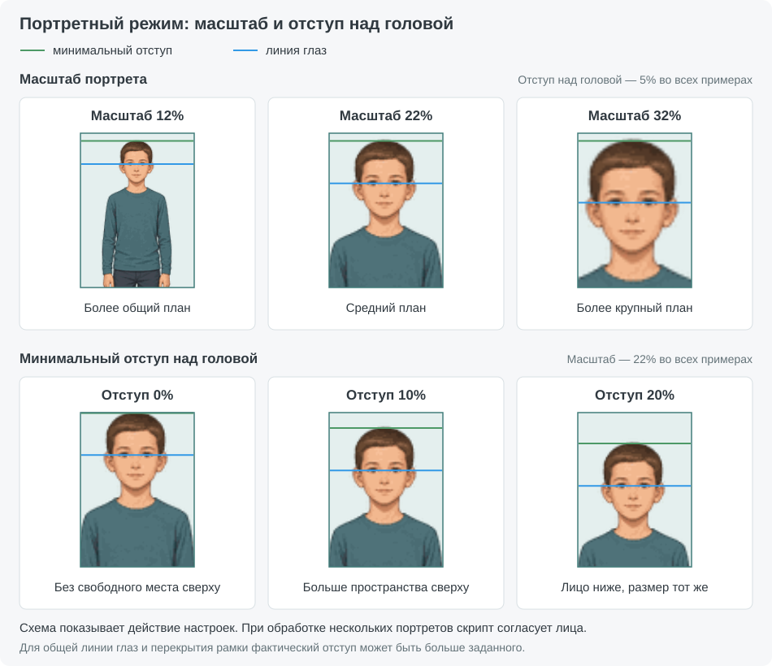

# Align and fit layers для Photoshop

**Align and fit layers** подбирает рамки для выбранных фотографий, масштабирует снимки и выравнивает человека или группу внутри каждой рамки. Учитывает положение объекта в кадре, заданные отступы и необходимость полностью перекрыть рамку фотографией.

Можно работать по цветовым меткам, с готовыми обтравочными масками или с одним общим слоем-образцом. Python добавляет определение людей, визуального центра и количества лиц; доступны и режимы средствами Photoshop.


## Установка и обновление

1. Полностью распакуйте архив.
2. Скопируйте из папки `Photoshop files` файл `Align and fit layers.jsx` и папку `lib` в папку сценариев Photoshop, например:

   ```text
   C:\Program Files\Adobe\Adobe Photoshop 2026\Presets\Scripts\
   ```

3. Перезапустите Photoshop. Скрипт появится в меню **Файл → Сценарии → Align and fit layers**.

Для режима **Python** один раз запустите `install_runtime.bat`. Выберите **Normal secure mode** и дождитесь успешного завершения. Если Kaspersky мешает HTTPS-загрузке, используйте режим совместимости **2**.

Установщик загружает отдельный Python и модели в `%LOCALAPPDATA%\JazzyScripts\AlignFitRuntime`. Интернет нужен для установки; уже установленный системный Python не меняется. Без этого модуля можно пользоваться доступными режимами Photoshop и режимом **«Границы слоя»**.

При обновлении замените JSX и папку `lib`. Папка `assets` нужна для иллюстраций README, копировать её в Photoshop не требуется.

## Быстрый старт

1. Назначьте фотографиям и предназначенным для них рамкам одинаковые цветовые метки Photoshop.
2. Выделите **только фотографии**.
3. Запустите скрипт, выберите способ определения объекта и отступы.
4. Нажмите **«Align and fit layers»**.

Для первого знакомства удобно взять две фотографии и две рамки с одной цветовой меткой. Скрипт сам выберет соответствие внутри этой цветовой группы. Если каждой паре нужна жёсткая привязка, используйте разные метки или заранее создайте обтравочные маски.

## Как выбирается рамка


| Ситуация | Что выделить | Результат |
| --- | --- | --- |
| Фотографии и отдельные рамки | Только фотографии | Подбор среди рамок с такой же цветовой меткой |
| Все выбранные фото уже в обтравочных масках | Только фотографии | Каждое фото использует своё существующее основание |
| Несколько фото нужно подогнать к одному образцу | Фото и самый нижний слой-образец | Общая рамка, если внешних рамок по меткам нет или их меньше половины необходимого количества |
| Обтравочная маска есть лишь у части выбранных фото | Нужные фотографии | Подбор по меткам; существующие связи не определяют выбор рамок |

### По цветовым меткам

Внутри одного цвета скрипт оценивает, как объект заполнит каждую рамку, насколько получится сохранить центрирование и избежать обрезки. Горизонтальный снимок может попасть в вертикальную рамку, если это даёт более подходящее размещение человека.

Рамками-кандидатами становятся **невыбранные слои с цветовой меткой**. Поэтому не назначайте ту же метку посторонним элементам оформления. Фотография перемещается к назначенной рамке в палитре слоёв и при необходимости становится её обтравочным слоем.

Если рамок недостаточно, но их хватает хотя бы для половины выбранных слоёв, появится предупреждение. **Продолжить** — разместить фото, которым найдены рамки, оставив остальные на месте; **Остановить** — отменить запуск. Если рамок меньше половины и выбрано несколько слоёв, включается вариант с общим нижним слоем.

### Готовые обтравочные маски

Когда **все** выбранные фотографии являются обтравочными слоями, цветовые метки не влияют на выбор. Используется существующее основание каждой цепочки. Можно выделить фото из разных обтравочных групп; несколько фото могут иметь одну общую рамку.

### Один общий слой-образец

Выделите фотографии вместе с рамкой и убедитесь, что рамка — **самый нижний из выбранных слоёв**. Чтобы не сработал подбор по внешним рамкам, не используйте у выбранных фото метки, совпадающие с другими рамками документа.

Остальные выбранные слои будут перемещены и масштабированы относительно образца. Сам образец и порядок слоёв сохраняются; новые обтравочные маски не создаются. Нижний слой-образец не должен сам быть обтравочным — в таком случае скрипт остановится.

## Способы выравнивания

| Режим | По чему выравнивается фотография | Что требуется |
| --- | --- | --- |
| **Python** | Человек или группа; учитывается визуальный центр по горизонтали | Установленный дополнительный модуль |
| **autoCutout — on device** | Объект, найденный Photoshop локально | Поддержка этого режима в Photoshop |
| **autoCutout — in cloud** | Объект, найденный Photoshop в облаке | Поддержка режима и интернет |
| **Границы слоя** | Весь слой целиком, с совмещением центров слоя и рамки | Дополнительный модуль не нужен |

В режиме **«Границы слоя»** фотография масштабируется до полного перекрытия рамки. Человек внутри неё отдельно не анализируется, отступы не применяются.


Если для отдельного фото не удалось определить пригодные границы объекта, оно автоматически обрабатывается по правилам **«Границы слоя»**. Другие фото продолжают использовать выбранный режим. При недоступности режима Python скрипт сообщает об ошибке.

### Количество лиц и визуальный центр

В режиме Python доступна включённая по умолчанию опция **«Учитывать количество лиц при подборе рамок»**. Она добавляет к оценке композиции предпочтение более крупных рамок для кадров с большим количеством людей. Полезна для набора из одиночных портретов и групповых снимков.

Эта галочка влияет на **подбор рамки**. Определение объекта и визуального центра работает и при выключенной галочке. При выравнивании скрипт учитывает положение людей и лиц; маленькие фигуры на заднем плане могут не влиять на композицию.


## Одинаковый масштаб одиночных портретов

В режиме **Python** включите **«Согласовать масштаб и линию глаз»**. Скрипт выравнивает масштаб лиц и высоту глаз на одиночных портретах. Групповые фотографии вписываются обычным способом. Опция по умолчанию выключена.



Верхний ряд показывает изменение масштаба при одинаковом отступе. Нижний — изменение отступа при одинаковом размере лица.

**«Масштаб портрета»** меняет кадрирование от общего плана к крупному. Процент рядом с ползунком помогает точно повторить настройку. Во время движения ползунка меняется число, а изображение обновляется после отпускания. Синяя линия в окне настроек показывает положение глаз, зелёная — минимальный отступ над головой. Схема помогает выбрать кадрирование; результат зависит от выбранных фотографий.

**«Мин. отступ над головой, %»** задаёт минимальное свободное место сверху в процентах высоты рамки. Это отдельная настройка портретов: основные отступы продолжают действовать для групп и обычного вписывания. Высота глаз подбирается автоматически. Чтобы согласовать линию глаз и полностью закрыть рамку фотографией, фактическое поле может быть больше заданного. Из-за разных причёсок свободное место над головами также может различаться.

Главный приоритет — одинаковый масштаб портретов и общая линия глаз. Размер определяется по нескольким измерениям лица; контур головы даёт небольшую поправку, чтобы причёска не определяла масштаб. Если выбранное значение недостижимо для всех снимков, скрипт подбирает общий доступный вариант. Когда одинаковый размер лиц сохранить можно, а общую линию глаз — нельзя, сохраняется масштаб. Различия размера допускаются только там, где ограничения исходников и рамок не позволяют согласовать его; портрет, который невозможно вписать с сохранением головы, обрабатывается обычным способом.

Масштаб и положение глаз согласуются относительно высоты рамки. При разных размерах рамок одинаковыми будут пропорции. Наклон головы сохраняется. Уже обрезанные исходным кадром части головы не восстанавливаются; само такое кадрирование не исключает надёжно найденное лицо из согласования. Если макушка обрезана исходником, заданный отступ над ней может быть недостижим.

При повторном запуске Python использует сохранённые измерения тех же слоёв: можно менять масштаб, отступ и другие настройки без повторного распознавания и подготовки превью. Кэш сохраняется, пока работает Python-сервер — обычно до 15 минут бездействия. Изменение выделения и возврат по истории не сбрасывают кэш. Слои сопоставляются по документу, ID, имени и типу. Если изменить содержимое слоя, сохранив эти признаки, старые измерения останутся в кэше; для повторного анализа такого слоя переименуйте его.

Блок настроек портрета находится ниже основных отступов и всегда остаётся видимым. В других режимах он недоступен; при возвращении к Python выбранные значения сохраняются. Чтобы применить их, включите согласование портретов. **Esc** закрывает окно без запуска.

## Отступы и кадрирование

Для вертикальных и горизонтальных рамок задаются **отдельные** отступы сверху, снизу и по бокам. Верхний и нижний — в процентах от высоты рамки, боковой — от её ширины.


- **Объект помещается целиком.** Скрипт стремится вписать его с заданными полями. Верхнее и нижнее поля приоритетнее боковых: свободного пространства по бокам может остаться больше.
- **Не хватает изображения вокруг объекта.** Поля могут уменьшиться, чтобы сама фотография полностью перекрывала рамку. Точное центрирование зависит от доступного запаса изображения.
- **Объект не помещается целиком или уже обрезан снизу исходным кадром.** Основная вертикальная привязка — верх объекта. Скрипт стремится сохранить верхний отступ; нижняя часть может выйти за рамку. Если сверху нет запаса изображения, верхнее поле уменьшается.

В Python по горизонтали используется визуальный центр, в Device/Cloud — центр найденной области. **Отступы — цель размещения, а не гарантия точного поля при любом исходном кадре.** Иллюстрации показывают принцип работы, а не точный результат для конкретной фотографии.

## Операции Photoshop и отмена

1. Начните запись операции.
2. Запустите скрипт, задайте параметры и выполните выравнивание.
3. Остановите запись.

Операция сохраняет способ определения объекта, основные отступы, настройку учёта лиц и параметры портретного режима: включение, масштаб и отдельный отступ над головой. Для автоматического выполнения шага отключите у него показ диалога. В режиме редактирования параметров операции окно позволяет сохранить настройки.

Во время выполнения используется прогресс Photoshop, включая этап **«Подготовка слоёв»**. Для прерывания нажмите **Esc**. Основное выравнивание выполняется одним шагом истории; результат можно отменить обычной командой **Отменить**.

## Частые вопросы

**Почему первый запуск Python медленнее?**  
Первый запуск требует подготовки распознавания. Повторные запуски обычно быстрее.

**Почему прогресс движется, пока Python ещё думает?**  
Это ориентировочный индикатор ожидания. Этап завершается, когда обработка действительно закончена.

**Почему Python отсутствует в списке?**  
Проверьте, что установка завершилась успешно и рядом с JSX сохранена папка `lib`. Если установка не завершилась, повторно запустите установщик.

**Почему вместо отдельных рамок используется нижняя фотография?**  
Для выбранных слоёв найдено слишком мало рамок с подходящими метками. Проверьте метки и выделение: в обычном режиме нужно выбирать только фото, в режиме общей рамки — также нижний слой-образец.

**Почему человек остался смещённым?**  
Проверьте режим: «Границы слоя» центрирует всю фотографию. При распознавании объекта на положение также влияют запас изображения у краёв и необходимость перекрыть рамку.

## Удаление

Удалите `Align and fit layers.jsx` и `lib/align-fit-api.pyw` из папки сценариев Photoshop. Если среда Python больше не нужна, дождитесь завершения её работы и удалите `%LOCALAPPDATA%\JazzyScripts\AlignFitRuntime`.


## Константы подготовки слоёв для Python-анализа

В начале `Photoshop files/Align and fit layers.jsx`:

- `USE_LEGACY_JPEG = false` — основной метод: растрирование, уменьшение слоя трансформацией с интерполяцией по ближайшему соседу, создание смарт-объекта и экспорт его содержимого в PSB без открытия. Чтение PSB встроено в основной `align-fit-api.pyw`. Если константа отсутствует, используется этот же метод.
- `USE_LEGACY_JPEG = true` — запасной метод: та же подготовка слоя, затем открытие смарт-объекта и сохранение временной JPEG-копии через Action Manager. Автоматического переключения между методами нет.
- `PREVIEW_MAX = 1280` — максимальная длина большей стороны изображения для анализа. Значение должно быть положительным; небольшие слои не увеличиваются. Размер и метод подготовки учитываются в ключе кэша.
